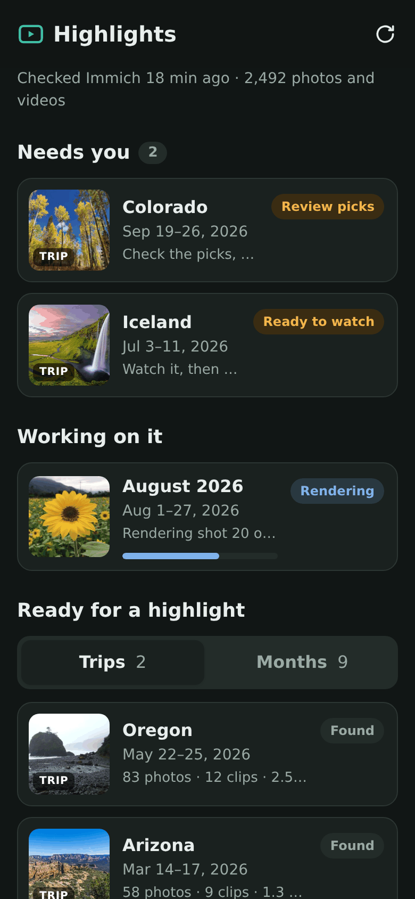
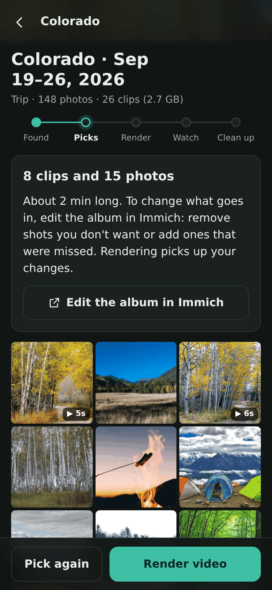
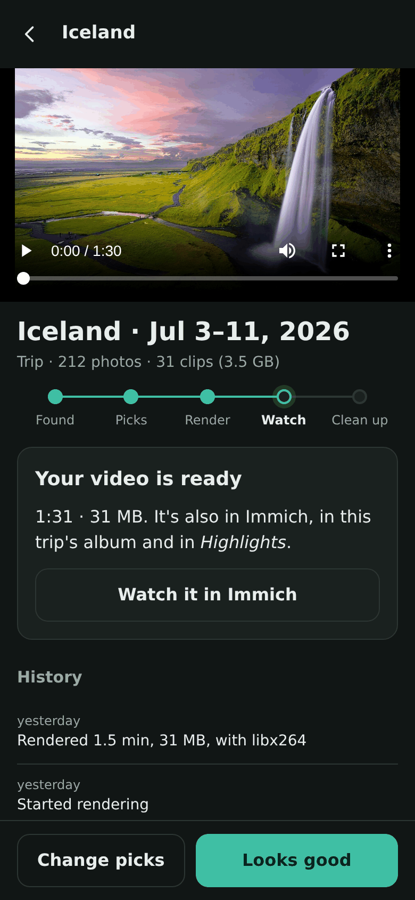
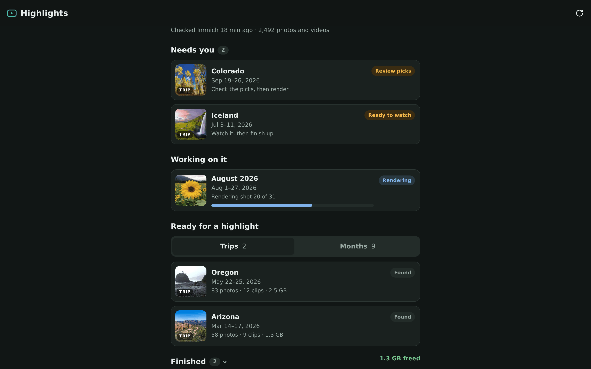
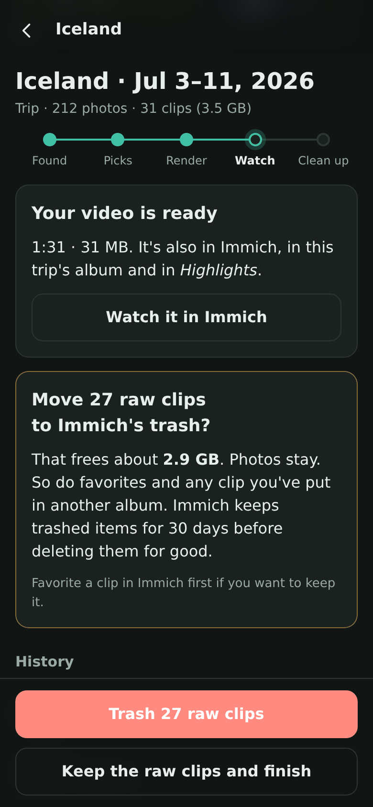
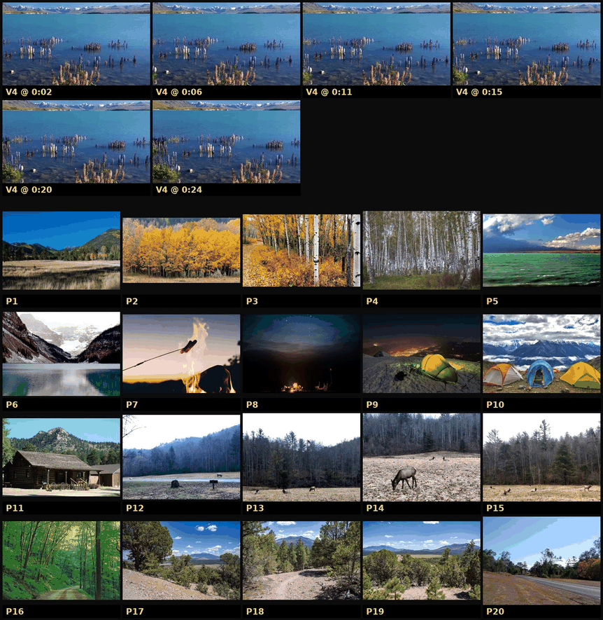

<p align="center">
  
</p>

<h1 align="center">Highlights</h1>

<p align="center">
  Turns the trips and months in your self-hosted <a href="https://immich.app">Immich</a> library
  into highlight videos.
</p>

<p align="center">
  <a href="https://github.com/jbarnell1/highlights/actions/workflows/ci.yml"></a>
  <a href="https://github.com/jbarnell1/highlights/tags"></a>
  <a href="LICENSE"></a>
  <a href="https://github.com/jbarnell1/highlights/pkgs/container/highlights"></a>
  <a href="https://github.com/jbarnell1/highlights/stargazers"></a>
  <a href="https://github.com/jbarnell1/highlights/commits/main"></a>
</p>

<p align="center">
  
  &nbsp;
  
  &nbsp;
  
</p>

<p align="center"><sub>Screenshots show a demo library of public domain photos, not a real one. See the <a href="docs/screenshots/CREDITS.md">credits</a>.</sub></p>

## What it is

Google Photos and Apple Photos turn a trip into a short video without being asked. Highlights
does that for a self-hosted Immich library, because nobody edits a week of phone clips by hand.
It finds the events, Claude picks the moments from contact sheets of every video and photo, and
ffmpeg cuts them into one video that lands back in Immich. A small phone web app shows where
each event is and has the buttons that move it along.

What makes it different: Immich stays the editor and the player. The picks are an ordinary Immich
album you can change before rendering, and the finished video is an ordinary Immich asset. If you
want a video editor with a timeline, this is not it.

## Features

- **Events are found for you.** Trips are runs of photos taken far from home; everything else
  groups by month. Nothing is touched until you press a button.
- **Claude picks, you edit in Immich.** The picks become an Immich album. Add or remove shots
  there before rendering; Highlights uses whatever is in the album.
- **The video lands back in Immich.** One 1080p file per event, added to the event's album and to
  a "Highlights" album, so it plays anywhere Immich does.
- **Renders on the GPU when there is one:** Intel Quick Sync or NVIDIA NVENC, else the CPU.
  HDR phone clips are tone mapped so the whole video plays as SDR.
- **Portrait clips and photos fit in.** Portrait shots get a blurred fill instead of black bars,
  and photos get a slow push-in.
- **Careful with your library.** Raw clips are only ever moved to Immich's trash, never deleted,
  and only when you turn cleanup on (after your library has an offsite backup). Favorites, photos
  and clips in other albums are never touched.
- **Made for the phone.** An installable web app with the buttons in thumb reach. Start a render,
  close the tab, and it keeps going on the server, one job at a time.
- **No API bill.** Picking runs through the Claude Code CLI on a Claude subscription (Pro or Max),
  so it counts against the plan instead of an API bill.

<p align="center">
  
  &nbsp;
  
</p>

## Quick start

Requirements: Docker with Compose, an Immich server, and a Claude subscription.

```bash
git clone https://github.com/jbarnell1/highlights && cd highlights
cp .env.example .env                      # then fill it in, see below
docker compose up -d                      # pulls ghcr.io/jbarnell1/highlights:latest
docker compose exec highlights hl check   # settings, Immich login, encoder, Claude Code
```

In `.env`:

1. `IMMICH_API_KEY`: in Immich, your avatar > Account Settings > API Keys > New API Key.
2. `CLAUDE_CODE_OAUTH_TOKEN`: run `claude setup-token` on any computer with Claude Code, sign in,
   and paste the token.
3. `IMMICH_LIBRARY`: the folder Immich stores originals in (its `UPLOAD_LOCATION`), if Immich runs
   on the same machine. It is mounted read-only.
4. `RENDER_GID`: for Intel Quick Sync, the output of `getent group render | cut -d: -f3`.

Then open it:

- **For a first look:** set `HL_BASE_PATH=/` in `.env`, run `docker compose up -d` again, and open
  <http://127.0.0.1:8040/> on the machine that runs Docker.
- **For everyday use:** the app listens on `127.0.0.1:8040` and, with the default
  `HL_BASE_PATH=/highlights`, expects a reverse proxy that serves it under `/highlights` and
  strips that prefix. For example
  `tailscale serve --bg --https=443 --set-path=/highlights http://127.0.0.1:8040`, then open
  `https://<your-machine>/highlights/`.

It has no login of its own: keep it on a private network.

`compose.yaml` joins Immich's Docker network (`immich_default`) and reaches it at
`http://immich_server:2283`. If Immich runs elsewhere, drop that network and set `IMMICH_URL`.
On a machine without an Intel GPU, remove the `devices` and `group_add` blocks; rendering then
runs on the CPU.

### Without Docker

Python 3.12, [uv](https://docs.astral.sh/uv/), ffmpeg (with zscale for HDR clips) and Claude Code
on `PATH`:

```bash
uv sync
cp .env.example ~/.highlights.env    # or set HL_ENV_FILE
uv run hl check
uv run hl serve --port 8040
```

Set `HL_DATA_DIR` for where the database and renders go, and `IMMICH_MEDIA_ROOT` to Immich's
originals folder if this machine can read it.

## What leaves your server

Self-hosters ask this first, so here is all of it.

**Contact sheets go to Anthropic. Originals never do.** Picking uses the
[Claude Code](https://docs.anthropic.com/en/docs/claude-code) CLI signed in with your Claude
subscription, and Claude is a cloud model. A local-model option does not exist yet (it is on the
[roadmap](docs/ROADMAP.md)).

Sheets are sent only when you press **Make a highlight** or **Pick again** for an event, or when
you render after adding videos to the album by hand (Claude then chooses which part of each to
use). Scanning never sends anything. What is sent:

- **One JPEG contact sheet per video:** 6 to 24 frames spaced through the clip, each 360 pixels
  wide, labeled with a ref and a time such as `V4 @ 0:11`.
- **JPEG sheets of photo thumbnails:** 20 per sheet, at most 280 pixels each, labeled `P1`, `P2`
  and so on. They are made from Immich's thumbnails, not the original files.
- **A few lines of text:** the event title (which holds the place name and dates, for example
  "Colorado · Sep 19-26, 2026"), how many videos and photos there are, how long each video is,
  the editing instructions, and the path of the temporary folder the sheets sit in.

This is what a video sheet and a photo sheet look like (demo photos; the sheets in the demo run
were roughly 100 to 350 KB each):

<p align="center">
  
</p>

What is not sent: original photos or videos, file names, GPS coordinates, faces or people data
from Immich, album names, and your Immich API key. Claude Code is started in a temporary folder
that holds only the sheets, with every tool except Read turned off, and the folder is deleted
afterwards. It answers with refs and times; all cutting happens locally with ffmpeg.

Two things to know about the Anthropic side:

- What Anthropic does with the images is governed by the terms and privacy settings of your
  Claude account. Check them before you use this on a family library.
- The Claude Code CLI is Anthropic's program, and by default it can also send its own usage
  metrics and error reports. The Docker image turns off its auto-updater. Adding
  `CLAUDE_CODE_DISABLE_NONESSENTIAL_TRAFFIC=1` to `.env` is meant to turn off the rest (see
  Claude Code's [data usage](https://docs.anthropic.com/en/docs/claude-code/data-usage) page).

Everything else stays on your network. Highlights itself talks to your Immich server and to
nothing else: no analytics, no update checks, no push service, no fonts or scripts from a CDN.
Scanning for events and rendering are fully local. Docker pulls the image from `ghcr.io`.

## Configuration

Everything is set in `.env`. These are the settings that matter, with the defaults from
`.env.example` and `compose.yaml`; [.env.example](.env.example) has the full list with comments.

| Setting | Default | What it does |
|---|---|---|
| `IMMICH_API_KEY` | none, required | API key of the Immich account whose library is used |
| `CLAUDE_CODE_OAUTH_TOKEN` | none, required | Subscription token from `claude setup-token` |
| `IMMICH_URL` | `http://immich_server:2283` | How the container reaches Immich |
| `IMMICH_PUBLIC_URL` | same as `IMMICH_URL` | The address you open Immich at, used for links from the app |
| `IMMICH_LIBRARY` | not mounted | Immich's originals folder on the host, mounted read-only so clips are read from disk instead of downloaded |
| `HL_DATA` | `./data` | Where the database, renders and caches go |
| `HL_BASE_PATH` | `/highlights` | The path a reverse proxy serves the app under. `/` if it gets its own hostname |
| `HL_MODEL` | `opus` | Model alias passed to Claude Code |
| `HL_HOME_LAT`, `HL_HOME_LON` | inferred | Pin where home is. By default it is where most photos were taken |
| `HL_AWAY_KM` | `80` | A trip is a run of photos more than this far from home |
| `HL_CLEANUP_ENABLED` | `false` | Allow moving an event's raw clips to Immich's trash |
| `RENDER_GID` | `44` | The host's `render` group, so the container may use Quick Sync |

## How it works

`found > picking > picks_ready > rendering > ready > (cleaning) > done`, plus `dismissed`.

1. **Scan** (daily, or on demand) reads photo times and places from Immich and groups them into
   trips and months (`events.py`).
2. **Pick**: each video becomes a contact sheet of frames labeled with times; photos go into
   labeled grids. Claude Code reads the sheets and returns clip times and photo refs as JSON
   (`picker.py`). Picks become an Immich album.
3. **Render** reconciles with that album, cuts each shot (blurred fill for portrait shots, slow
   push-in on photos, HDR tone mapping), joins them and uploads the video to Immich, into the
   event's album and a "Highlights" album (`media.py`, `pipeline.py`). Rendering an event again
   moves its previous highlight video to Immich's trash.
4. **Clean up** (optional, off by default) moves the event's raw clips to Immich's trash.

## Documentation

| Document | What it answers |
|---|---|
| [README](README.md) | What it is, how to install it, what leaves your server |
| [.env.example](.env.example) | Every setting, with comments |
| [docs/DECISIONS.md](docs/DECISIONS.md) | Why it is built this way: the design decisions, newest first |
| [docs/ROADMAP.md](docs/ROADMAP.md) | What works, known limits, and ideas for later |
| [CONTRIBUTING.md](CONTRIBUTING.md) | How to set up, where the code lives, and the rules a change has to keep |
| [SECURITY.md](SECURITY.md) | How to run it safely and how to report a vulnerability |
| [CODE_OF_CONDUCT.md](CODE_OF_CONDUCT.md) | How people are expected to treat each other here |
| [docs/screenshots/CREDITS.md](docs/screenshots/CREDITS.md) | How the screenshots were made and where the demo photos come from |

## Project status and roadmap

Used by one household. Expect rough edges. It has been run against a single Immich install, the
image is amd64 only, and there is no login, no music and no local-model picker yet. The full list
of limits and the ideas for what comes next are in [docs/ROADMAP.md](docs/ROADMAP.md).

Highlights is an independent project. It is not affiliated with Immich or Anthropic.

## How it was built

Highlights was built with heavy help from [Claude Code](https://docs.anthropic.com/en/docs/claude-code):
the model wrote most of the code, tests and docs, directed by the maintainer, who runs it on a
real household library. It is tested with 30 unit tests that use a fake Immich and need no
network, GPU or Claude account. They cover event detection, pick parsing and clamping, the
ffmpeg commands, the pipeline steps including the cleanup rules, and every page at every stage.
CI runs the tests and `ruff` on every push, builds the Docker image and checks that ffmpeg with
Quick Sync and the Claude Code CLI are inside it, and scans the full git history for secrets
with gitleaks. There are no browser tests and no automated tests against a real Immich server or
the real Claude service; that part is covered only by being used.

## Contributing

Bug reports and pull requests are welcome. [CONTRIBUTING.md](CONTRIBUTING.md) has the setup and
the rules; the short version is:

```bash
uv sync
uv run pytest -q
uv run ruff check .
```

Please follow the [Code of Conduct](CODE_OF_CONDUCT.md).

## Security

Highlights has no login and holds an Immich API key, so run it only on a private network. Report
vulnerabilities privately through GitHub (Security > Report a vulnerability), not in a public
issue. Details are in [SECURITY.md](SECURITY.md).

## License

[AGPL-3.0](LICENSE).
